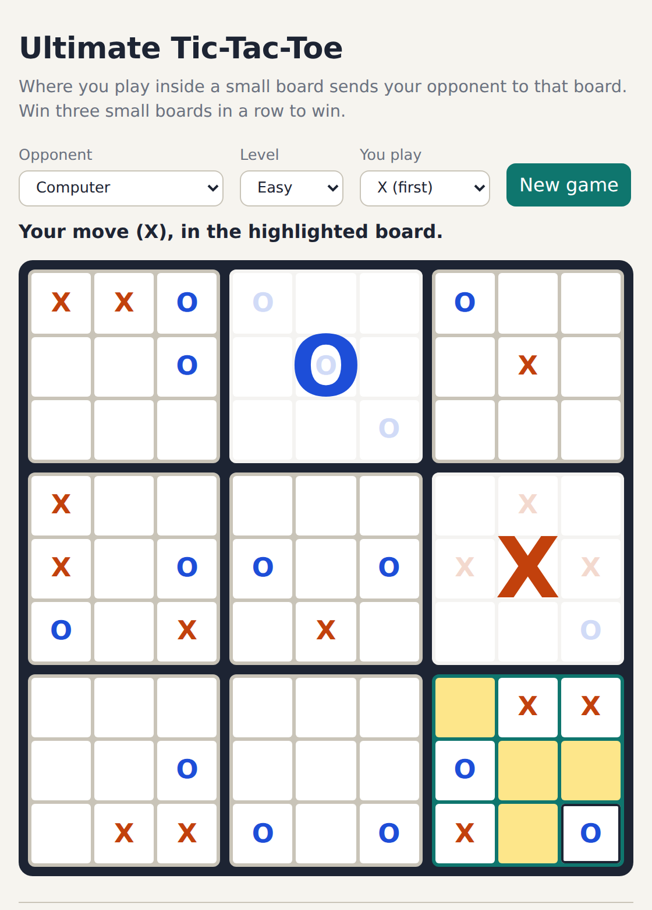

# Ultimate Tic-Tac-Toe

[](https://github.com/Abdelrahman-521/ultimate-tictactoe-server/actions/workflows/ci.yml)

A playable, browser-based **Ultimate Tic-Tac-Toe** with a REST API, accounts, a saved win/loss record and a computer opponent that thinks with Monte Carlo tree search.



**The rules in one line:** wherever you play inside a small board sends your opponent to that board. Win three small boards in a row to win the game.

## Run it

```bash
pip install -r requirements.txt
python -m uttt.server          # open http://localhost:8080
```

Play a friend on the same screen, or the computer on easy, normal or hard. Logging in is optional; it keeps your record against the computer.

```bash
pip install -r requirements-dev.txt
pytest                         # 23 tests: rules, AI, storage, every API route
```

## The API

JSON in, JSON out, real status codes (`201` created, `400` illegal move, `401` bad login, `404` unknown game, `409` game over).

| Method | Route | Does |
|---|---|---|
| `POST` | `/api/games` | New game. `{"mode": "local" \| "ai", "level": "easy" \| "normal" \| "hard", "human": "X" \| "O"}` |
| `GET` | `/api/games/<id>` | Board, whose turn, which small board is active, legal moves, winner, move history |
| `POST` | `/api/games/<id>/moves` | `{"board": 0-8, "cell": 0-8}`. Against the computer, its reply comes back in the same response |
| `POST` | `/api/users` | Sign up |
| `POST` | `/api/sessions` | Log in, returns a bearer token |
| `GET` | `/api/users/<name>` | Wins, losses and draws against the computer |

```bash
curl -s -X POST localhost:8080/api/games -d '{"mode":"ai","level":"hard"}' -H 'Content-Type: application/json'
```

## How it's built

| File | What it does |
|---|---|
| [`uttt/engine.py`](uttt/engine.py) | The rules: the "send" rule, free moves when sent to a decided board, small-board wins and draws, whole-game wins and draws |
| [`uttt/ai.py`](uttt/ai.py) | Computer player: Monte Carlo tree search (UCT, random playouts, 60 / 600 / 2,500 iterations by level). Always takes a winning move and avoids handing over one |
| [`uttt/store.py`](uttt/store.py) | SQLite storage. Passwords are salted PBKDF2-SHA256 hashes. Games are stored as move lists and rebuilt by replaying them, so an illegal position can't be saved |
| [`uttt/server.py`](uttt/server.py) | The Bottle REST API and the static web page |
| [`web/`](web/) | The front end: plain HTML, CSS and JavaScript, no build step, works on a phone, follows dark mode |
| [`tests/`](tests/) | pytest for the engine, AI and storage, and WebTest for every route |

## History: course project, then a rebuild

**Winter 2024, COMP 2005 (Software Engineering), Memorial University.** A five-person Agile team project: Brandon Jarvis (user module), Wesley Hamlyn (game logic), David Pike (storage), Abdullah Ahmed Talaha (HTML pages) and me, Abdelrahman Conber. **I owned the server API**: the HTTP layer between the browser and the game, with its UML, architecture notes, a stub server so the front end could start early, and unit tests. We worked in sprints with a Kanban board, code reviews on pull requests and meeting notes. My original files are kept unchanged in [`course_version/`](course_version/). The team's other modules stay in the course repository and aren't copied here.

At the end of term the pieces never ran together. The API imported the game logic under a module name that didn't exist, every move started from a fresh board instead of the saved game, login didn't check stored accounts, and the unit tests imported a module that wasn't there.

**October 2026: rebuilt so it actually works.** I rebuilt the game end to end with Claude Code as a pair programmer, keeping the shape of my original API (new game, load game, make a move, user info) and adding what it was missing:

- a complete rules engine, written from scratch
- real persistence in SQLite, with hashed passwords and login tokens
- a computer opponent using Monte Carlo tree search
- a front end that works on a phone
- 23 automated tests running on GitHub Actions

## Tech
Python · Bottle · REST / JSON · SQLite · Monte Carlo tree search · JavaScript · HTML / CSS · pytest · WebTest · GitHub Actions
