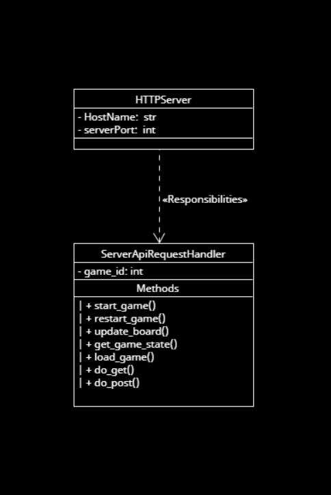

# Ultimate Tic-Tac-Toe Game Server

The server side of a browser-based **Ultimate Tic-Tac-Toe** game: a small REST API that creates, loads, updates and saves games, plus the HTML pages the player sees.

Term project for COMP 2005 (Software Engineering) at Memorial University, built by a five-person Agile team.

## My part: the server API
I owned `server/serverAPI.py`, the HTTP layer between the browser and the game logic.

- **Routes:** `/new_game`, `/load_game`, `/make_move`, `/load_game_status`, `/save_game_status` and `/user_info`
- **Built with:** Python and the Bottle WSGI framework, returning JSON
- **Persistence:** saves and restores games through the team's storage module
- **Design:** UML and architecture notes in [`docs/`](docs/), and a stub server (`server/stub_serverAPI.py`) so the front end could be built before the real API was ready
- **Tests:** `tests/test_ServerApi.py`

## Front end
Static pages in `web/`: login, registration, password renewal, game board and stats.

## How the team worked
Sprint planning, a Kanban board, UML architecture docs, unit tests and pull-request code reviews.

## Note
This repo is a showcase of my contribution. The full game logic and storage modules lived in the team's course repository.

## Tech
Python · Bottle · REST / JSON · HTML · unittest · Git / GitHub · Agile
